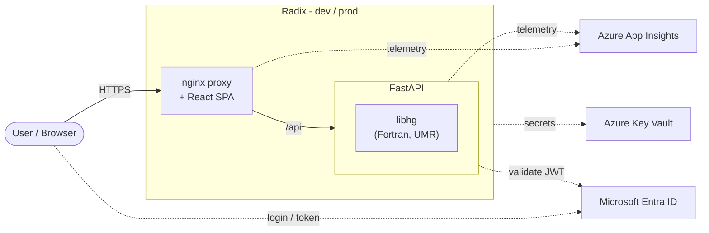

<!-- markdownlint-configure-file {
  "MD033": false,
  "MD041": false
} -->

# Mercury

[![License][license-badge]][license]
[![On push main branch][on-push-main-branch-badge]][on-push-main-branch-action]
[![SCM Compliance][scm-badge]][scm-policy]

This is an application to perform phase equilibrium calculations for mercury.

[About](#about) • [Development](#development) • [Contributing](#Contributing)

## :books: About

Mercury is a calculator. You give it a gas or oil mixture at a chosen temperature and pressure, and it tells you where the mercury in that mixture ends up. This matters in oil and gas processing because mercury is toxic and attacks equipment such as aluminium heat exchangers. Engineers need to know whether it will stay in the gas, collect in the liquids, dissolve in water, or settle out as pure mercury.

See the [documentation][docs-about] for more information about the thermodynamic model used in Mercury Calculator.

### Architecture

Mercury is a React web app with a FastAPI backend that performs the calculations. The thermodynamics lives in `libhg`, a library from the private [gpa-libhg](https://github.com/equinor/gpa-libhg) repo. The compiled module is downloaded when the API Docker image is built, so building the image requires a GitHub token (`LIBHG_PAT`) with read access to gpa-libhg. See the [setup guide](docs/developers/guide/setup.md#secrets).

## :dizzy: Development

See the [developer guide][docs-development] if you want to start developing.

## :+1: Contributing

Thanks for your interest in contributing! There are many ways to contribute to this project.

Please see the [contributing guidelines][docs-contributing] for more information.

[license-badge]: https://img.shields.io/badge/License-MIT-blue.svg
[license]: https://github.com/equinor/mercury/blob/main/LICENSE.md
[on-push-main-branch-badge]: https://github.com/equinor/mercury/actions/workflows/on-push-main-branch.yaml/badge.svg
[on-push-main-branch-action]: https://github.com/equinor/mercury/actions/workflows/on-push-main-branch.yaml
[scm-badge]: https://scm-compliance-api.radix.equinor.com/repos/equinor/mercury/badge
[scm-policy]: https://developer.equinor.com/governance/scm-policy/
[docs-about]: https://varia.equinor.com/docs/default/system/mercury#about
[docs-development]: https://varia.equinor.com/docs/default/system/mercury/developers/guide/
[docs-contributing]: https://varia.equinor.com/docs/default/system/mercury/contributing
